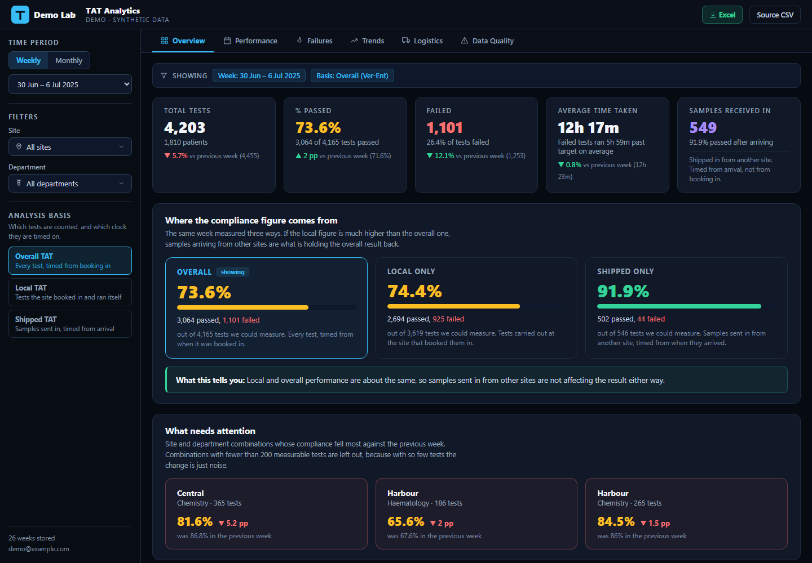

# Lab TAT analytics platform: public demo

> **In short:** At work, the weekly report on how quickly our nine labs return test results used to take a full day to put together in Excel, and it was already a week old by the time anyone read it. I built a web dashboard that does the same job in about two minutes, and lab supervisors now use it every day. Since then, the share of results delivered on time has gone from about 50% to over 70%.
>
> This demo is that dashboard running on made-up data, so you can click through it yourself. **What it shows:** I build tools that people outside the data team actually use.

A turnaround-time (TAT) dashboard I built for a nine-site diagnostic lab network, where it is in daily use by lab supervisors and management. This repository is a public copy that runs on **synthetic data with no database**, so the real thing can be seen without exposing patient or company data.

**[Open the live demo →](https://yusuf-tiamiyu.github.io/lab-tat-platform-demo/)**



## The problem it solved

TAT is the time from when a sample is booked in to when its result is verified. Before this platform, the lab exported a flat file from its LIS once a week, cleaned it by hand in Excel and emailed the result around. It took a working day, and by the time anyone read it the problems were a week old.

In production:

- weekly reporting went from a full day of manual work to about two minutes
- network TAT compliance moved from around 50% to over 70% after supervisors started using it in daily operational calls
- failures can now be traced to a specific site, department, shift and test

## What the dashboard does

| Tab | Question it answers |
|---|---|
| Overview | How did this week or month go, and which site/department combinations got worse? |
| Performance | Daily and hourly volume and compliance; which shifts and tests are slow |
| Failures | How late were the late tests? Severity bands, a site × department heatmap and a Pareto of the tests causing most failures |
| Trends | Week-on-week and month-on-month compliance, by site and department |
| Logistics | Samples referred between sites: routes, volumes, and compliance timed from arrival |
| Data Quality | Rows that couldn't be scored, zero-TAT artefacts, impossible timestamps |

Compliance can be viewed three ways: **overall** (every test, timed from booking), **local** (tests run at the site that booked them) and **shipped** (referred samples, timed from arrival). Comparing them shows whether referrals are what's pulling a site's number down.

## How it's built

```
Weekly LIS export (.xlsx)
   │  read in the browser by SheetJS
   ▼
src/lib/processExcel.js   ETL: parse Excel serial dates, map site codes, compute TAT,
   │                      classify local vs referred, assign shift, band failures,
   │                      roll up to day / site / department / test / hour / shift
   ▼
Supabase (Postgres)       ~20 tables, row-level security, uploads limited to named accounts
   ▼
React + Recharts          src/App.jsx, src/pages/Failures.jsx, aggregation in src/lib/aggregate.js
```

Decisions worth calling out, each made after finding a real error in an earlier version:

- **Every table stores counts and sums, never pre-computed percentages.** Rates are calculated once, at display time, from summed numerators and denominators. An earlier version stored percentages and rebuilt them when combining days or sites, which produced figures up to 15.8 points wrong depending on which filters were used.
- **Unmeasurable tests are excluded, not failed.** Rows with no verification time or no target are counted separately and shown on the Data Quality tab instead of being silently scored as failures.
- **Zero-TAT results are tracked separately**, so compliance can be shown with and without them rather than quietly counting them as passes.
- **Every failure is recorded.** An earlier version only listed failures more than an hour late, which hid over a fifth of them, including every failure at the smallest sites.
- **Queries page past the API row limit.** Supabase's REST layer returns at most 1,000 rows per request without saying so; `fetchAllRows` pages through with `.range()` until a short page comes back.
- **Access control lives in the database.** An early version checked a shared password in browser JavaScript after the data was already readable. Access is now enforced by Postgres row-level security and Supabase Auth, and only accounts on an uploaders list can write.

## What's different in this demo

| Production | Demo |
|---|---|
| Real LIS exports | 26 weeks of synthetic exports from [lab-tat-breach-analysis](https://github.com/Yusuf-Tiamiyu/lab-tat-breach-analysis), same column layout |
| Supabase backend and sign-in | `src/lib/supabase.js` serves static JSON through a stand-in for the supabase-js query builder; no sign-in |
| Real site codes and names | Nine fictional sites |
| Weekly upload | Turned off. `scripts/build-demo-data.mjs` runs the same `processExcelFile()` over the synthetic exports at build time |
| Company name and logo | Removed |

The ETL, aggregation and every page component are the production code.

## Run it locally

```bash
npm install
node scripts/build-demo-data.mjs path/to/exports   # optional: data is already in public/data
npm run dev
```

## Stack

React 18, Vite, Recharts, SheetJS (xlsx), Supabase (Postgres, Auth, row-level security) in production.
